# 🎄 Phishing — Phishmas Greetings | TryHackMe AoC 2025 (Day 12) Write-Up

[](https://tryhackme.com/room/spottingphishing-aoc2025-r2g4f6s8l0)
[](https://tryhackme.com/room/spottingphishing-aoc2025-r2g4f6s8l0)
[](https://tryhackme.com/room/spottingphishing-aoc2025-r2g4f6s8l0)
[](https://tryhackme.com/room/spottingphishing-aoc2025-r2g4f6s8l0)
[](#-quick-answer--flag-sheet)

A complete, fun, and forensic walkthrough of **TryHackMe's Advent of Cyber 2025 — Day 12: "Phishing — Phishmas Greetings."**

In this room, automated email defenses at **The Best Festival Company (TBFC)** have gone dark, and King Malhare's **Eggsploit Bunnies** are bombarding Wareville employees with holiday-themed lures. Our job is to step into the **Wareville Email Threat Inspector**, manually dissect six suspicious emails, separate harmless marketing spam from targeted phishing attacks, and pinpoint the exact phishing signals in each message.

> [!WARNING]
> **Spoilers ahead!** This write-up contains the complete analysis, exact phishing signal combinations, and all six flags for the room. Try triaging the inbox yourself first — half the fun is playing detective in the headers!

---

## 📖 Table of Contents

- [🎄 The Story & Core Idea: Why Manual Triage Matters](#-the-story--core-idea-why-manual-triage-matters)
- [🧠 The Phish-Hunter's Field Guide (Core Concepts)](#-the-phish-hunters-field-guide-core-concepts)
  - [1. Spam vs. Phishing: Annoying Noise vs. Precision Strike](#1-spam-vs-phishing-annoying-noise-vs-precision-strike)
  - [2. Header Forensics 101: Who *Actually* Sent This?](#2-header-forensics-101-who-actually-sent-this)
  - [3. Spoofing vs. Impersonation vs. Punycode Homographs](#3-spoofing-vs-impersonation-vs-punycode-homographs)
  - [4. "Trending Phishing": Living Off Trusted Cloud Apps](#4-trending-phishing-living-off-trusted-cloud-apps)
- [🗺️ Manual Triage Decision Flow](#️-manual-triage-decision-flow)
- [🕵️‍♂️ Case Files: Dissecting All 6 Emails](#️️-case-files-dissecting-all-6-emails)
  - [Case #1: Invoice from Santa Claus (4103)](#case-1-invoice-from-santa-claus-4103)
  - [Case #2: New Audio Message from McSkidy](#case-2-new-audio-message-from-mcskidy)
  - [Case #3: URGENT: McSkidy VPN access for incident response](#case-3-urgent-mcskidy-vpn-access-for-incident-response)
  - [Case #4: TBFC HR Department shared "Annual Salary Raise Approval.pdf" with you](#case-4-tbfc-hr-department-shared-annual-salary-raise-approvalpdf-with-you)
  - [Case #5: Improve your event logistics this SOC-mas season](#case-5-improve-your-event-logistics-this-soc-mas-season)
  - [Case #6: TBFC-IT shared "Christmas Laptop Upgrade Agreement" with you](#case-6-tbfc-it-shared-christmas-laptop-upgrade-agreement-with-you)
- [🚩 Quick Answer & Flag Sheet](#-quick-answer--flag-sheet)
- [🛡️ Key Takeaways for Defenders](#️-key-takeaways-for-defenders)
- [📂 Repository Structure](#-repository-structure)

---

## 🎄 The Story & Core Idea: Why Manual Triage Matters

Ever since **McSkidy** disappeared, TBFC's security posture has been hanging by a tinsel thread. Now, the **Email Protection Platform** has been knocked offline. Automatic classification is disabled, leaving the SOC team with only **Manual Mode** inside the **Wareville Email Threat Inspector**.

Meanwhile, **Malhare's Eggsploit Bunnies** are working overtime to turn **SOC-mas** into **EAST-mas**. They are firing off fake PayPal invoices, bogus voicemail notifications, urgent incident-response requests, fake HR salary bumps, and sneaky laptop upgrade agreements.

### What the Room Teaches You
The big idea behind **Phishmas Greetings** is that **no single indicator catches every phish**:
- Sometimes the **headers fail authentication** (`SPF`/`DKIM`/`DMARC` all fail) because the attacker forged a domain they don't own (**Spoofing**).
- Sometimes the **headers pass authentication** because the attacker created a free `@gmail.com` account, registered a lookalike **Punycode domain** (`tbƒc.com` $\rightarrow$ `xn--tbc-n5a.com`), or sent the notification through a **legitimate service like Dropbox**!
- And sometimes an unsolicited email in the queue isn't an attack at all — it's just **Spam** trying to sell event logistics software.

To beat the room, you have to combine **technical header/URL inspection** with **psychological analysis** of the message body, classify each email as **Phishing** or **Spam**, and — for every phishing email — select the **three exact phishing signals** that define the attack.

---

## 🧠 The Phish-Hunter's Field Guide (Core Concepts)

Before diving into the six emails, here is the mental toolkit the room builds for you.

### 1. Spam vs. Phishing: Annoying Noise vs. Precision Strike

Not every unwanted email is a security incident. Knowing the difference keeps SOC analysts from chasing ghosts:

| Dimension | 🥫 Spam | 🎣 Phishing |
|---|---|---|
| **Goal** | Marketing, promotion, lead generation, or bulk ad traffic | Credential theft, malware execution, financial fraud, or unauthorized access |
| **Targeting** | Spray-and-pray (bulk B2B/B2C outreach) | Tailored to impersonate trusted brands, executives, IT/HR, or internal workflows |
| **Call to Action** | *"Reply if you'd like a demo of our platform"* | *"Open this `.html` attachment"*, *"Call this fraud number now"*, *"Issue VPN creds immediately"* |
| **Risk to TBFC** | Cluttered inbox (low security risk) | Compromised accounts, ransomware, wire fraud, or a ruined SOC-mas |

### 2. Header Forensics 101: Who *Actually* Sent This?

Email works a lot like physical paper mail: anyone can write `From: Santa Claus <santa@northpole.org>` on the letterhead inside an envelope, even if they mailed it from a basement in Wareville. When inspecting headers, always compare three addresses and three authentication checks:

- **`From:` (Header From):** What the user sees in their email client. **Trivially forged** if authentication isn't enforced.
- **`Return-Path:` (Envelope Sender / `MAIL FROM`):** Where bounce messages go — this reveals the actual sending server/account that handed the message to SMTP.
- **`Reply-To:`:** Where the victim's reply is routed when they hit "Reply." Attackers love setting `Reply-To:` to an external `outlook.com` or `gmail.com` inbox when abusing legitimate notification services.
- **`Authentication-Results:`:**
  - **SPF (Sender Policy Framework):** Checks if the sending IP is authorized to send mail on behalf of the `Return-Path` (`smtp.mailfrom`) domain.
  - **DKIM (DomainKeys Identified Mail):** Verifies a cryptographic signature (`header.d`) proving the domain actually signed the message and the body wasn't tampered with in transit.
  - **DMARC (Domain-based Message Authentication, Reporting, and Conformance):** Checks alignment between the visible `From:` domain and the authenticated `SPF`/`DKIM` domains, and tells the receiver what policy (`none`, `quarantine`, `reject`) to apply.

### 3. Spoofing vs. Impersonation vs. Punycode Homographs

One of the trickiest parts of email triage is telling these three apart:

1. **Spoofing:** The attacker directly forges a legitimate domain in the `From:` address (e.g., `service@paypal.com` or `calls@tbfc.com`), while the `Return-Path` belongs to a completely unrelated domain (`bbunny378.onmicrosoft.com` or `easterbb.com`) and `SPF`/`DKIM`/`DMARC` fail.
2. **Impersonation:** The attacker pretends to be a trusted person or department (like `McSkidy`, `TBFC HR Department`, or `TBFC-IT`) using display names and pretexts, often from an external/free domain (`mcskiddyy202512@gmail.com` or `dropbox.com`).
3. **Typosquatting & Punycode (IDN Homograph Attacks):**
   - **Typosquatting** registers a slightly misspelled domain like `microsoftooline.co` (double `o`, `.co` TLD) instead of `microsoftonline.com`.
   - **Punycode** converts Unicode characters from non-ASCII scripts into DNS-compatible ASCII strings starting with `xn--`. For example, swapping the standard Latin `f` in `tbfc.com` with the Latin small letter f with hook **`ƒ`** (`U+0192`) looks nearly identical in the UI (`tbƒc.com`), but DNS resolves it as **`xn--tbc-n5a.com`**!

### 4. "Trending Phishing": Living Off Trusted Cloud Apps

Why send a sketchy attachment from a shady server when you can get **Dropbox** or **OneDrive** to send the email for you?
Modern attackers upload a lure document (like *"Annual Salary Raise Approval.pdf"*) to a real Dropbox account and use Dropbox's "Share" feature. Because the email genuinely comes from `no-reply@dropbox.com` via Amazon SES, **it passes spam filters**, and the attacker puts their own trap address (`hr.tbfc@outlook.com`) in the `Reply-To` header and embeds a link to a secondary credential harvester inside the shared note.

---

## 🗺️ Manual Triage Decision Flow

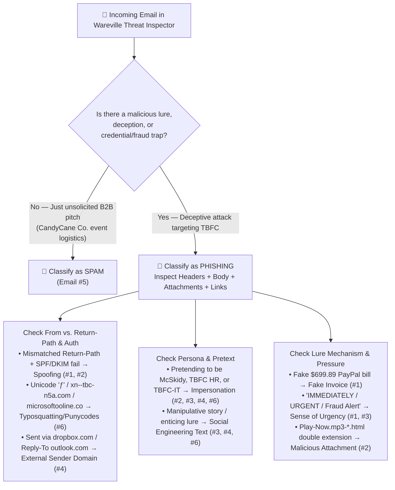

---

## 🕵️‍♂️ Case Files: Dissecting All 6 Emails

Below is the step-by-step investigation of every email in the **Wareville Email Threat Inspector**, complete with the exact artifacts highlighted during triage.

> [!TIP]
> **How the Inspector's Grader Works:** Under the hood, the Wareville Email Threat Inspector checks that you select **strictly the 3 expected signals** defined for each phishing email. Even if an email arguably hints at a 4th signal (for example, asking someone to call a phone number or reply to a personal Gmail could also look like a *Side Channel Communication Attempt*), selecting a 4th box will trigger an `Incorrect` pill. The walkthrough below explains both the **3 required signals** and the extra real-world nuances!

---

### Case #1: `Invoice from Santa Claus (4103)`

#### 📋 Message Metadata

| Field | Value Observed |
|---|---|
| **Subject** | `Invoice from Santa Claus (4103)` |
| **From** | `"service@paypal.com" <service@paypal.com>` |
| **To** | `"naeryn@tbfc.com" <naeryn@tbfc.com>` |
| **Date** | `Fri, 12 Dec 2025 10:36:44 -0700` |
| **Return-Path** | `bounces+SRS=qVbic=PZ@bbunny378.onmicrosoft.com` |
| **Authentication-Results** | `spf=fail (sender IP is 209.222.82.143) smtp.mailfrom=Danielle378.onmicrosoft.com; dkim=fail (body hash did not verify) header.d=paypal.com; dmarc=fail action=oreject` |
| **Attachments** | None |

#### 🔍 What's Going On Here?
Naeryn receives a scary-looking PayPal invoice claiming **Santa Claus** just billed them **$699.89 USD** for an easter egg order (`Invoice number 4103`). Right in the "Note from seller," it screams:
> *"Fraud Alert, Didn't make this easter egg order? Call PayPal immediately at +1 (800) XMAS-1225"*

This is a textbook **Fake Invoice / Callback Phishing (TOAD — Telephone-Oriented Attack Delivery)** scam:
1. **Spoofing:** The visible `From` header claims to be `"service@paypal.com" <service@paypal.com>`, and the HTML loads genuine PayPal fonts (`paypalobjects.com`) to look authentic. However, looking at the headers reveals total carnage:
   - `RETURN-PATH` is `bounces+SRS=qVbic=PZ@bbunny378.onmicrosoft.com` (hello, **bbunny378** — one of Malhare's Eggsploit Bunnies!).
   - `AUTHENTICATION-RESULTS` shows a triple failure: `spf=fail`, `dkim=fail (body hash did not verify)`, and `dmarc=fail action=oreject`.
2. **Fake Invoice:** The entire lure is a bogus `$699.89 USD` PayPal invoice designed to make the victim panic about unauthorized charges.
3. **Sense of Urgency:** Phrases like *"Fraud Alert"* and *"Call PayPal immediately"* are engineered to short-circuit critical thinking and make the victim act right away.

#### ✅ Verdict & Signals

- **Classification:** `Phishing`
- **Phishing Signals (3):**
  - `Spoofing`
  - `Sense of Urgency`
  - `Fake Invoice`
- **Flag:** `THM{yougotnumber1-keep-it-going}`

<details open>
<summary>📸 <strong>Evidence Screenshots — Email #1</strong></summary>

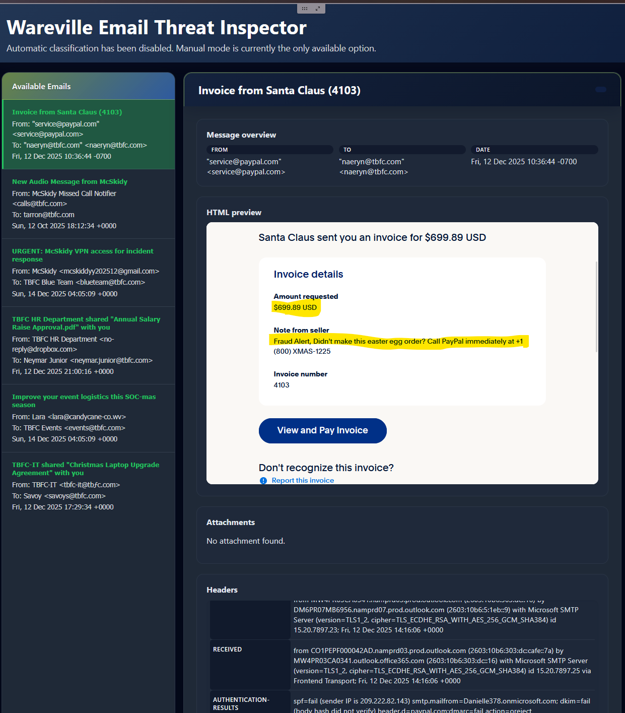

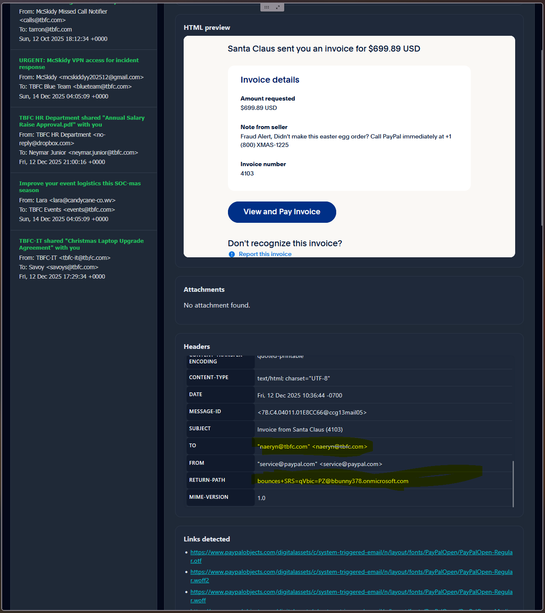

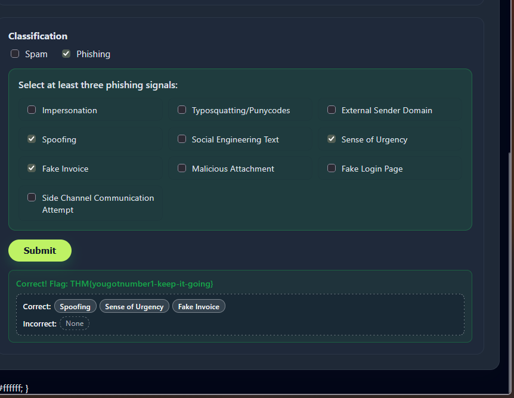

</details>

---

### Case #2: `New Audio Message from McSkidy`

#### 📋 Message Metadata

| Field | Value Observed |
|---|---|
| **Subject** | `New Audio Message from McSkidy` |
| **From** | `McSkidy Missed Call Notifier <calls@tbfc.com>` |
| **To** | `tarron@tbfc.com` |
| **Reply-To** | `TBFC <noreply@tbfc.com>` |
| **Date** | `Sun, 12 Oct 2025 18:12:34 +0000` |
| **Return-Path** | `zxwsedr@easterbb.com` |
| **Attachments** | `Play-Now.mp3-29a-otpqw-warq-29.html` (`application/octet-stream`, `1.7 KB`) |

#### 🔍 What's Going On Here?
Everyone at TBFC is desperate to hear from the missing McSkidy, so an email titled **`New Audio Message from McSkidy`** claiming there is an **88-second voice message** is irresistible bait for Tarron.

Let's break down the three signals:
1. **Impersonation:** The attacker masquerades as an internal VoIP/voicemail service (`McSkidy Missed Call Notifier`) delivering a voice recording from **McSkidy**.
2. **Spoofing:** Both `From:` (`calls@tbfc.com`) and `Reply-To:` (`noreply@tbfc.com`) use TBFC's internal domain. Flip down to the `RETURN-PATH` header, however, and the mask slips off: the message actually originated from **`zxwsedr@easterbb.com`** (an Easter Bunny domain!).
3. **Malicious Attachment:** Look closely at the attached "audio" file:
   ```text
   Play-Now.mp3-29a-otpqw-warq-29.html
   ```
   It uses a classic **double-extension trick** (`.mp3-...html`). It's not an MP3 audio clip at all — it's a `1.7 KB` **HTML file** (`application/octet-stream`) that, when double-clicked, opens in the victim's browser to harvest credentials or execute malicious scripts locally!

#### ✅ Verdict & Signals

- **Classification:** `Phishing`
- **Phishing Signals (3):**
  - `Impersonation`
  - `Spoofing`
  - `Malicious Attachment`
- **Flag:** `THM{nmumber2-was-not-tha-thard!}`

<details open>
<summary>📸 <strong>Evidence Screenshots — Email #2</strong></summary>

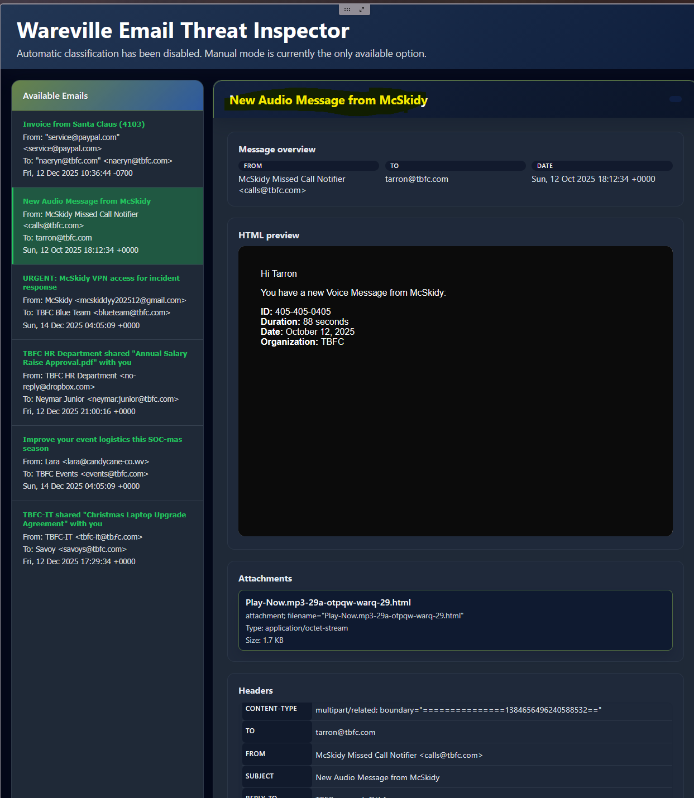

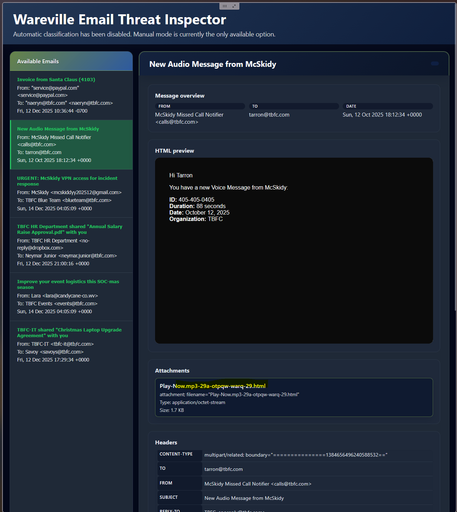

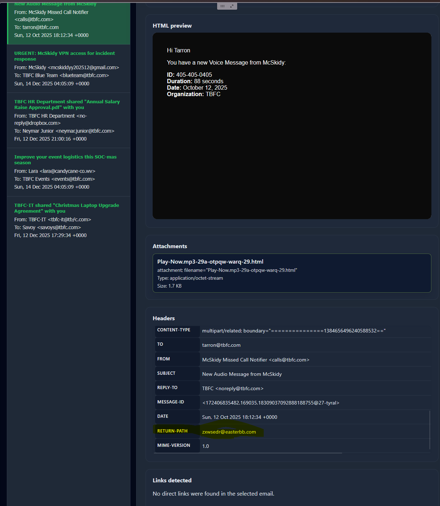

</details>

---

### Case #3: `URGENT: McSkidy VPN access for incident response`

#### 📋 Message Metadata

| Field | Value Observed |
|---|---|
| **Subject** | `URGENT: McSkidy VPN access for incident response` |
| **From** | `McSkidy <mcskiddyy202512@gmail.com>` |
| **To** | `TBFC Blue Team <blueteam@tbfc.com>` |
| **Date** | `Sun, 14 Dec 2025 04:05:09 +0000` |
| **Return-Path** | `mcskiddyy202512@gmail.com` |
| **Message-ID** | `<CAGVzd0ERMObw8GhH+bMsXYkKdFyfHL0npp+mM04e1GJonK44wg@mail.gmail.com>` |
| **Attachments / Links** | None |

#### 🔍 What's Going On Here?
This is a classic **CEO/Executive Fraud & Helpdesk Social Engineering** attack (with Zero links and Zero attachments!) aimed straight at the **TBFC Blue Team**:
> *"Team, McSkidy here — I'm currently unreachable by phone. We have an ongoing incident and need the Blue Team to get remote access now to investigate. Please create a new VPN access for me immediately. Send the access to my personal email address mcskiddyy202512@gmail.com ... This is urgent — please action immediately."*

Notice why traditional link/attachment scanners often miss this style of attack: there is no malware payload or phishing link in the email. The payload is **pure human manipulation**:
1. **Impersonation:** The sender claims to be **McSkidy** (head of the Blue Team) using a freshly minted free Gmail address (`mcskiddyy202512@gmail.com` — complete with a double `y`!). Note that this is *not* spoofing, because `From` and `Return-Path` both honestly say `gmail.com`.
2. **Social Engineering Text:** The attacker crafts a high-pressure operational pretext (*"ongoing incident"*, *"unreachable by phone"*) to trick the Blue Team into provisioning unauthorized VPN credentials and emailing them outside the company.
3. **Sense of Urgency:** Every sentence hammers the panic button: `URGENT:` in the subject line, *"get remote access now"*, *"immediately"*, and red italicized text reading *"This is urgent — please action immediately."*

> 💡 **Analyst Note:** Although the room's reading material also points out that claiming *"I'm currently unreachable by phone"* and asking to send credentials to a personal Gmail is a side-channel tactic, the Inspector's answer key for Email #3 specifically expects **Impersonation**, **Social Engineering Text**, and **Sense of Urgency**.

#### ✅ Verdict & Signals

- **Classification:** `Phishing`
- **Phishing Signals (3):**
  - `Impersonation`
  - `Social Engineering Text`
  - `Sense of Urgency`
- **Flag:** `THM{Impersonation-is-areal-thing-keepIt}`

<details open>
<summary>📸 <strong>Evidence Screenshots — Email #3</strong></summary>

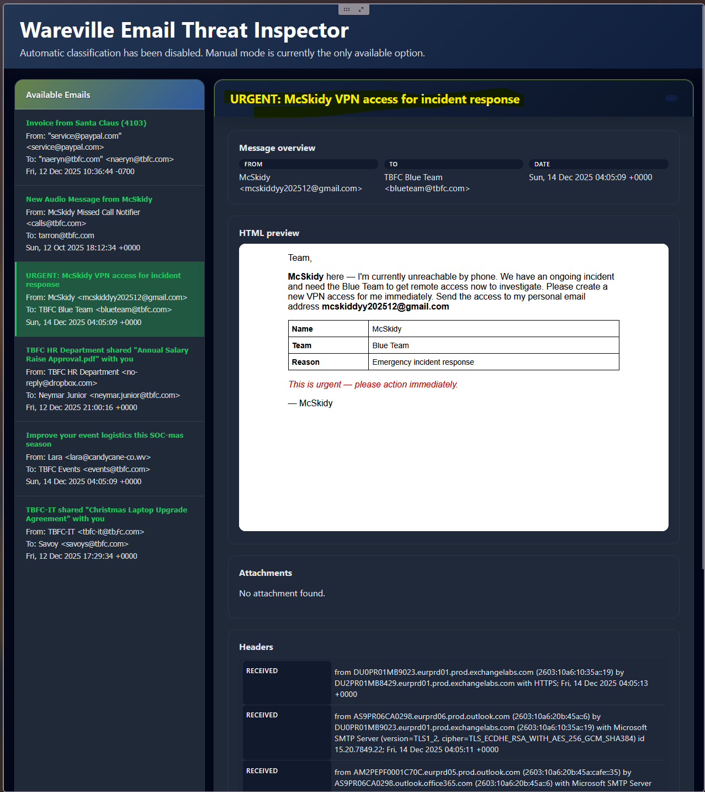

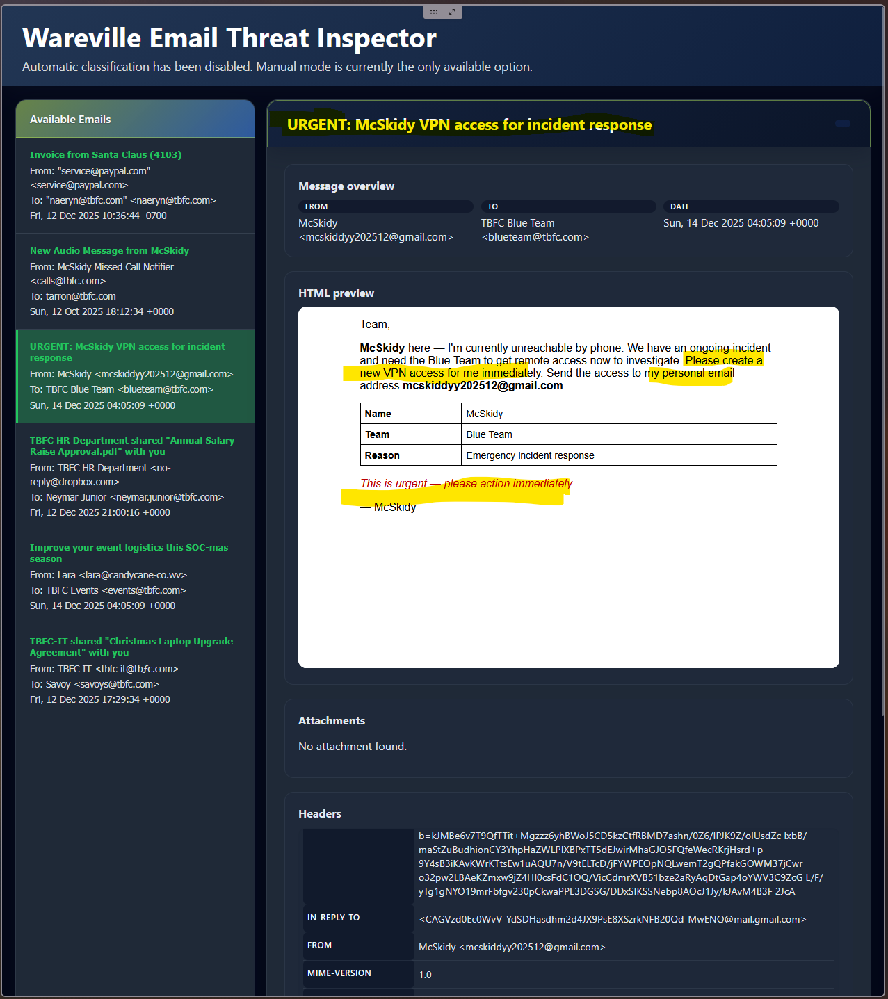

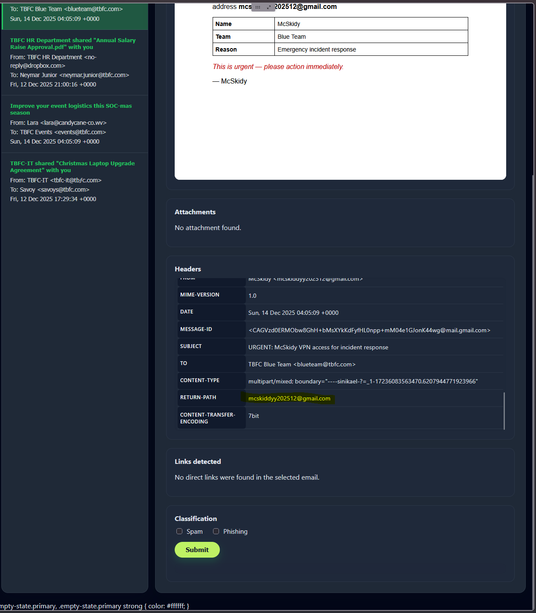

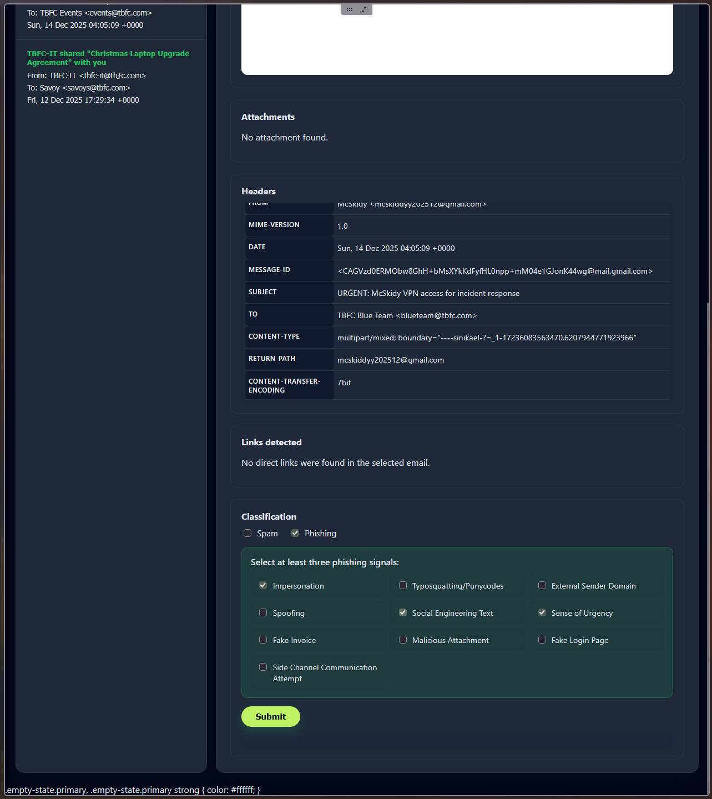

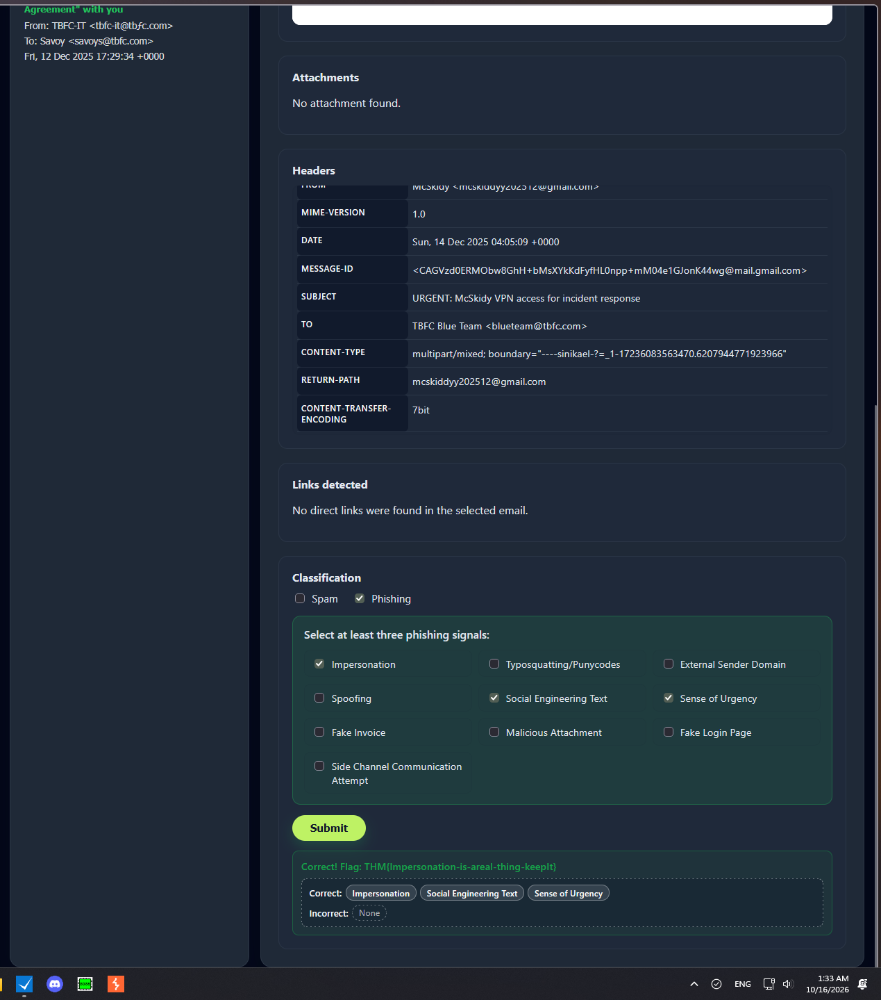

</details>

---

### Case #4: `TBFC HR Department shared "Annual Salary Raise Approval.pdf" with you`

#### 📋 Message Metadata

| Field | Value Observed |
|---|---|
| **Subject** | `TBFC HR Department shared "Annual Salary Raise Approval.pdf" with you` |
| **From** | `TBFC HR Department <no-reply@dropbox.com>` |
| **To** | `Neymar Junior <neymar.junior@tbfc.com>` |
| **Reply-To** | `hr.tbfc@outlook.com` |
| **Date** | `Fri, 12 Dec 2025 21:00:16 +0000` |
| **Message-ID** | `3612436312273@us-west-2.amazonses.com` |
| **Return-Path** | `345675444334263@email.dropbox.com` |
| **Links Detected** | Legitimate `dropbox.com` share URLs (`https://www.dropbox.com/l/scl/AACsXe1xmrtgdCP5FFny-TmiHK765YmIjLdd`, etc.) |

#### 🔍 What's Going On Here?
Who doesn't want a holiday pay bump? Neymar Junior gets a notification that **`TBFC HR Department (hr.tbfc@outlook.com)`** invited him to view **`"Annual Salary Raise Approval.pdf"`** on Dropbox:
> *"Hi there, You have a pending document to be signed regarding you recent Salary Raise Approval. You can copy and paste the URL below if you do not have a DropBox account: https://www.dropbox.com/scl/fi/xzruzfwqa4w77ozxvq00i/annual-salary-raise-approval.pdf?blablablabla Thank you, TBFC HR Department"*

This is a textbook example of **"Trending Phishing" — Living Off Trusted Cloud Applications**:
1. **Impersonation:** The attacker sets their Dropbox display name to **`TBFC HR Department`** and signs the note as TBFC HR to impersonate an internal department.
2. **External Sender Domain:** Instead of coming from `@tbfc.com`, the email is sent via **`@dropbox.com`** (`no-reply@dropbox.com` / `email.dropbox.com`) with a **`Reply-To`** pointing to a free personal Microsoft account: **`hr.tbfc@outlook.com`**. Why would TBFC's internal HR department use a free `@outlook.com` address and an external consumer Dropbox account to handle confidential salary approvals? They wouldn't!
3. **Social Engineering Text:** An unexpected **"Annual Salary Raise Approval"** plays directly on curiosity and reward (greed/excitement) to get the employee to click **`Open file`** without questioning the external sender. (Even the `?blablablabla` query string and typo *"regarding you recent"* give away the handcrafted lure!)

#### ✅ Verdict & Signals

- **Classification:** `Phishing`
- **Phishing Signals (3):**
  - `Impersonation`
  - `External Sender Domain`
  - `Social Engineering Text`
- **Flag:** `THM{Get-back-SOC-mas!!}`

<details open>
<summary>📸 <strong>Evidence Screenshots — Email #4</strong></summary>

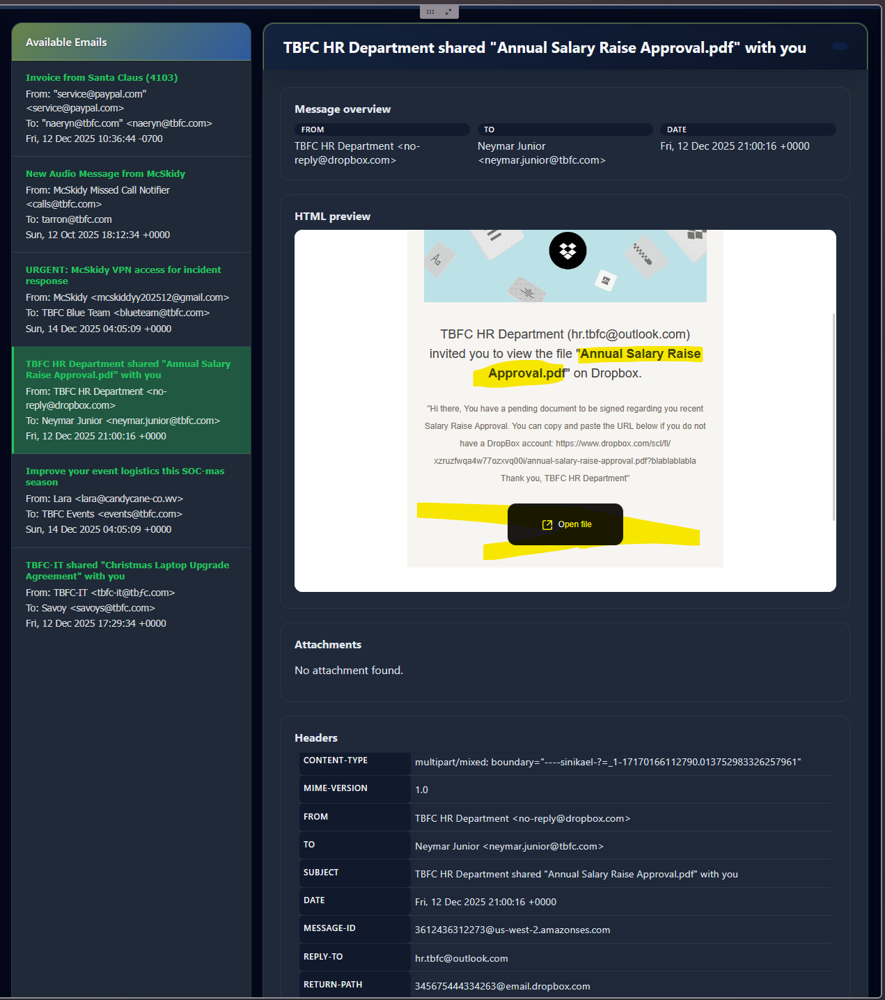

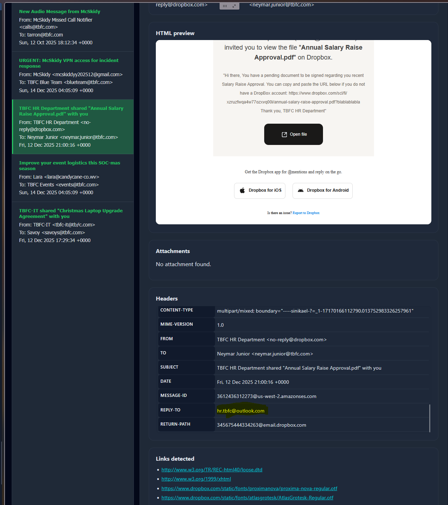

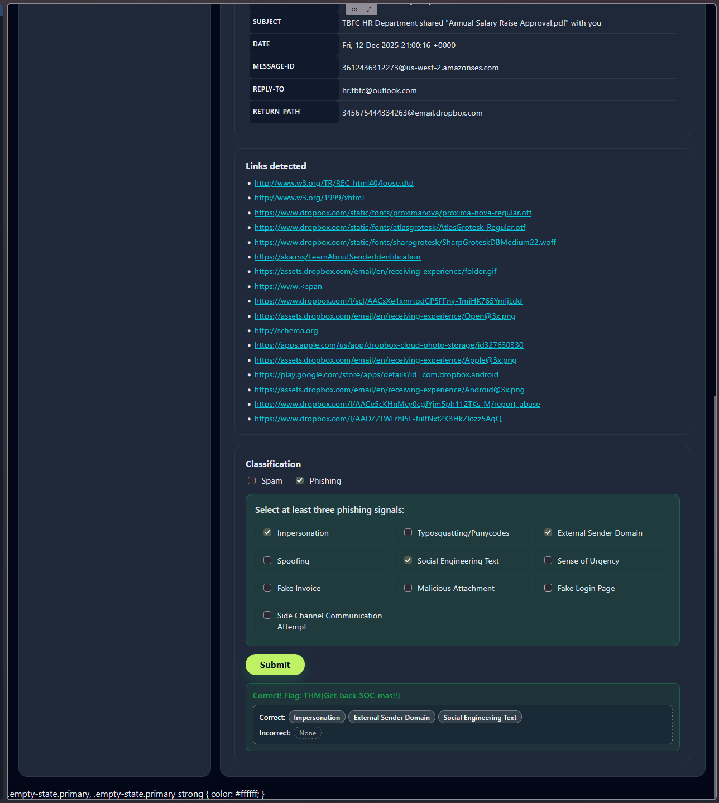

</details>

---

### Case #5: `Improve your event logistics this SOC-mas season`

#### 📋 Message Metadata

| Field | Value Observed |
|---|---|
| **Subject** | `Improve your event logistics this SOC-mas season` |
| **From** | `Lara <lara@candycane-co.wv>` |
| **To** | `TBFC Events <events@tbfc.com>` |
| **Date** | `Sun, 14 Dec 2025 04:05:09 +0000` |
| **Attachments** | `No attachment found.` |
| **Links Detected** | `No direct links were found in the selected email.` |

#### 🔍 What's Going On Here?
Lara, an "Event Solutions Advisor" at **CandyCane Co.** (`45 Frostbite Avenue, Wareville`), writes to `events@tbfc.com` pitching the **CandyCane Co. Logistics Platform** (automated scheduling, centralized supply tracking, real-time updates, energy-efficient systems).

Let's check for malicious indicators:
- **Attachments?** None.
- **Phishing links?** None (`No direct links were found in the selected email`).
- **Impersonation or Spoofing?** None — Lara is openly emailing from her own company (`lara@candycane-co.wv`) to TBFC's public-facing events team (`events@tbfc.com`).
- **Urgent credential/payment demands?** None — just *"I'd love to learn how TBFC currently handles event logistics and see if our solution could support your preparations for SOC-mas."*

**Conclusion:** Put down the banhammer! This is pure, unsolicited B2B cold outreach — **Spam**, not Phishing.

#### ✅ Verdict & Signals

- **Classification:** `Spam` *(no phishing signals selected)*
- **Flag:** `THM{It-was-just-a-sp4m!!}`

<details open>
<summary>📸 <strong>Evidence Screenshot — Email #5</strong></summary>

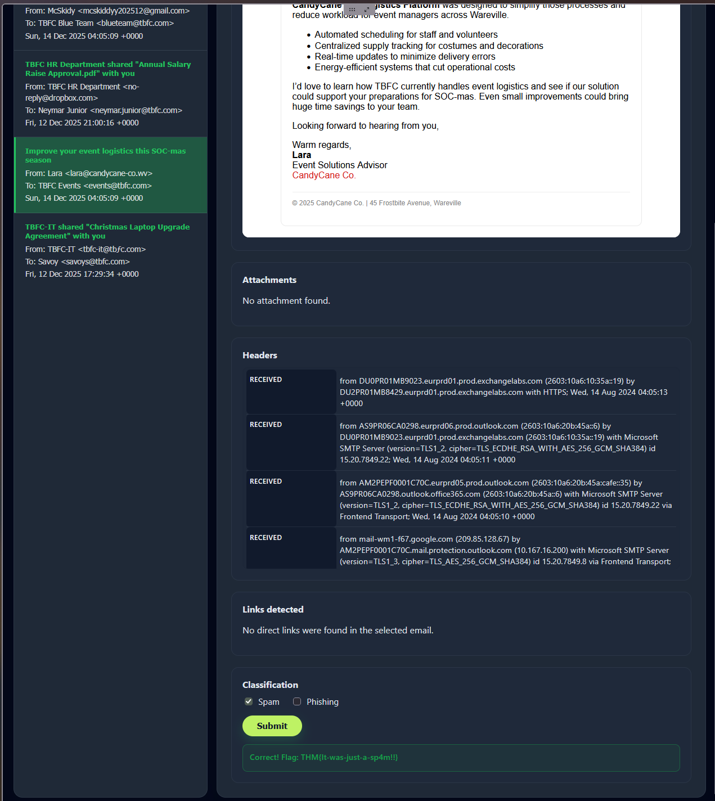

</details>

---

### Case #6: `TBFC-IT shared "Christmas Laptop Upgrade Agreement" with you`

#### 📋 Message Metadata

| Field | Value Observed |
|---|---|
| **Subject** | `TBFC-IT shared "Christmas Laptop Upgrade Agreement" with you` |
| **From** | `TBFC-IT <tbfc-it@tbƒc.com>` *(note the hook on `ƒ`!)* |
| **To** | `Savoy <savoys@tbfc.com>` |
| **Date** | `Fri, 12 Dec 2025 17:29:34 +0000` |
| **Return-Path** | `tbfc-it@xn--tbc-n5a.com` |
| **Authentication-Results** | `spf=pass (sender IP is 148.163.129.48) smtp.mailfrom=tbƒc.com; dkim=pass (signature was verified) header.d=NETORGFT5333146.onmicrosoft.com; dmarc=none action=none header.from=tbƒc.com;` |
| **Links Detected** | `https://microsoftooline.co`, `http://microsoftooline.co` *(plus Microsoft/SharePoint font & privacy assets)* |

#### 🔍 What's Going On Here?
Saved the sneakiest for last! Savoy receives a slick Microsoft OneDrive/SharePoint notification saying **`TBFC-IT shared a file with you: Christmas Laptop Upgrade Agreement`**. Even better, if an analyst lazily glances only at `spf=pass` and `dkim=pass` in `AUTHENTICATION-RESULTS`, they might think it's legitimate!

Look closer — there is a **double homograph / typosquatting trap** here:
1. **Typosquatting / Punycodes:**
   - **In the Sender Domain:** Look at `tbfc-it@tbƒc.com`. That `ƒ` is **not** an ASCII `f` — it is the Unicode character `U+0192` (*Latin Small Letter F with Hook*). Looking at the `RETURN-PATH` header confirms it immediately: **`tbfc-it@xn--tbc-n5a.com`**! Because the attacker actually registered `xn--tbc-n5a.com` on a Microsoft 365 tenant (`NETORGFT5333146.onmicrosoft.com`), `SPF` and `DKIM` pass *for the fake Punycode domain*!
   - **In the Embedded Links:** Under **Links detected**, the **"Open"** button doesn't go to SharePoint or OneDrive — it points to **`https://microsoftooline.co`** and **`http://microsoftooline.co`** (typosquatting `microsoftonline.com` with `oo` instead of `on` and `.co` instead of `.com`).
2. **Impersonation:** The attacker poses as TBFC's internal IT department (**`TBFC-IT`**) using a forged Microsoft OneDrive file-share template.
3. **Social Engineering Text:** Who wouldn't click **"Open"** on a **"Christmas Laptop Upgrade Agreement"** from IT right before the holidays? The enticing hardware-upgrade bait is designed to lure Savoy into entering Microsoft 365 credentials on `microsoftooline.co`.

#### ✅ Verdict & Signals

- **Classification:** `Phishing`
- **Phishing Signals (3):**
  - `Impersonation`
  - `Typosquatting/Punycodes`
  - `Social Engineering Text`
- **Flag:** `THM{number6-is-the-last-one!-DX!}`

<details open>
<summary>📸 <strong>Evidence Screenshots — Email #6</strong></summary>

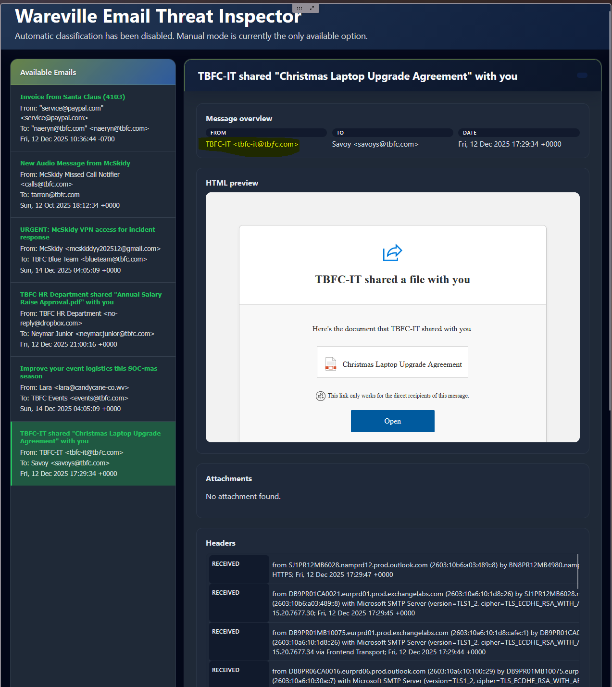

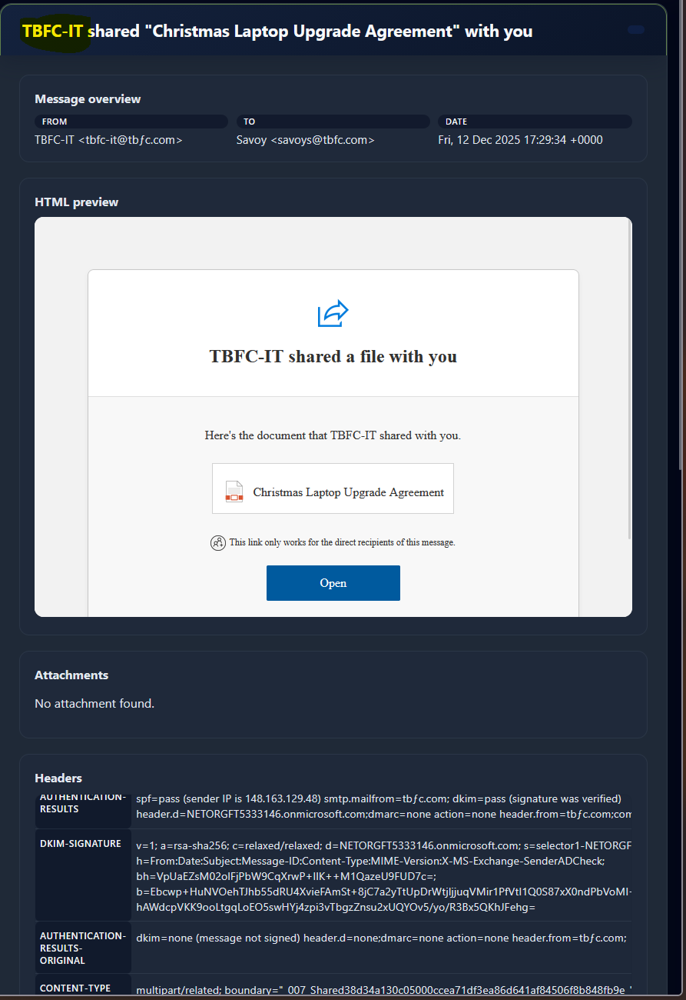

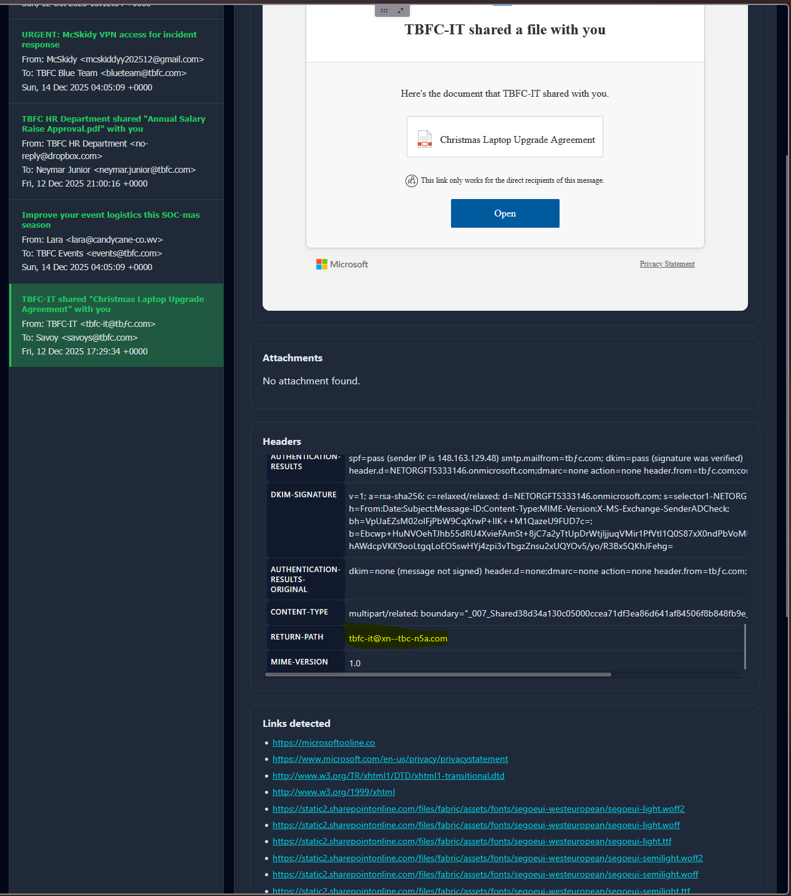

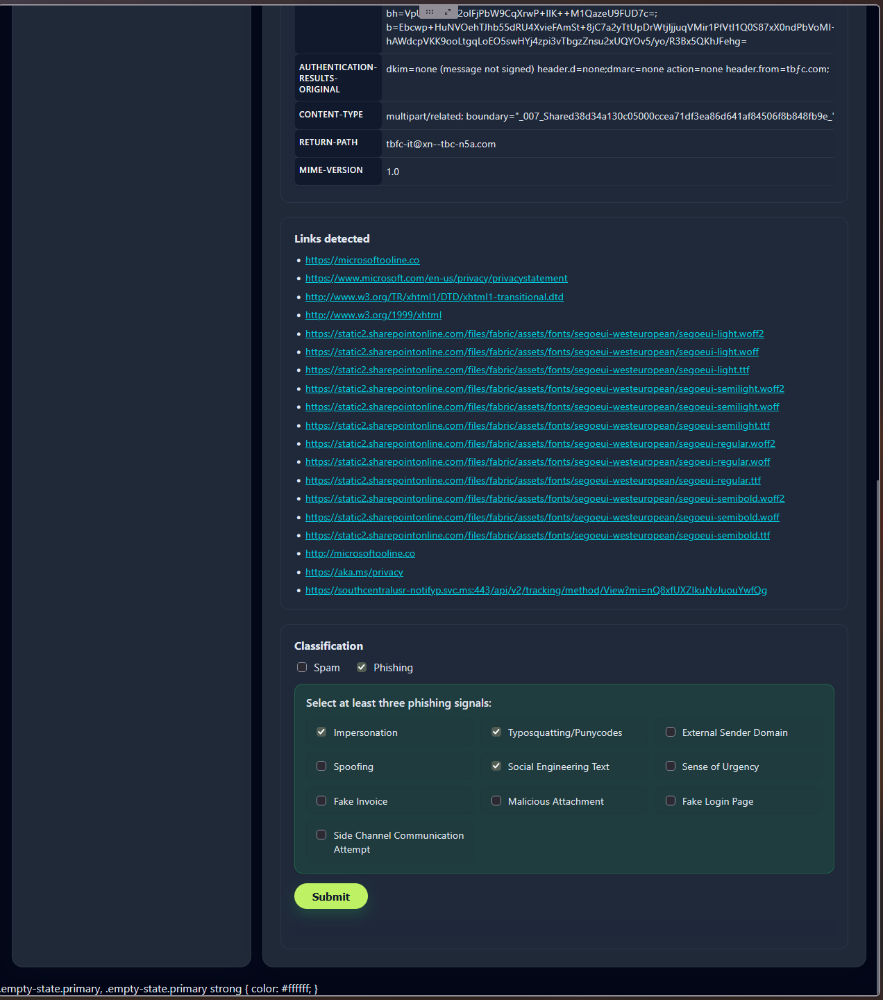

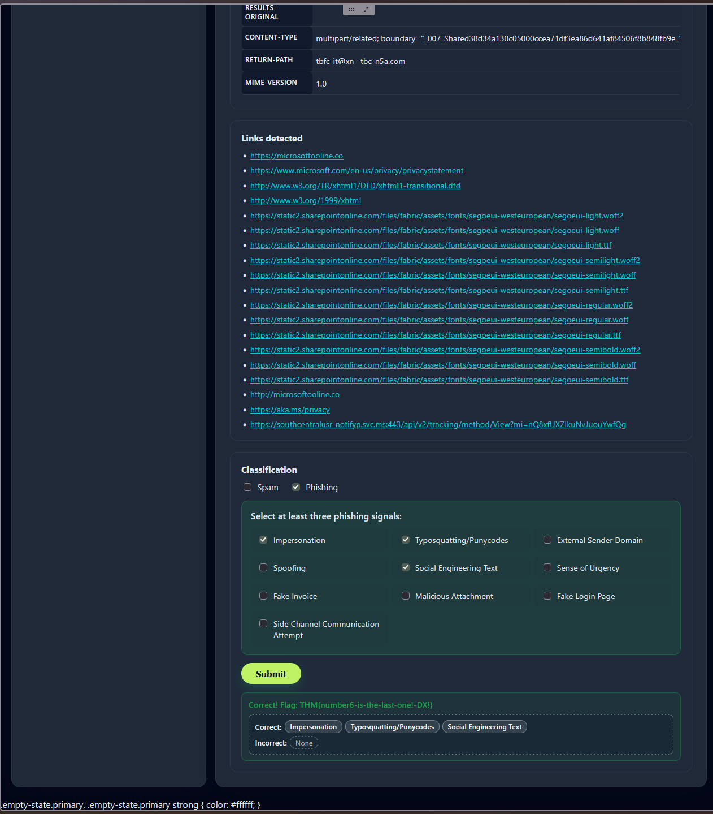

</details>

---

## 🚩 Quick Answer & Flag Sheet

Here is the complete summary table of all six emails, their classifications, the exact three signals required by the **Wareville Email Threat Inspector**, and the resulting flags:

| # | Email Subject | Classification | Required Signals (Select 3) | Flag |
|---|---|---|---|---|
| **1** | `Invoice from Santa Claus (4103)` | **Phishing** | `Spoofing`, `Sense of Urgency`, `Fake Invoice` | `THM{yougotnumber1-keep-it-going}` |
| **2** | `New Audio Message from McSkidy` | **Phishing** | `Impersonation`, `Spoofing`, `Malicious Attachment` | `THM{nmumber2-was-not-tha-thard!}` |
| **3** | `URGENT: McSkidy VPN access for incident response` | **Phishing** | `Impersonation`, `Social Engineering Text`, `Sense of Urgency` | `THM{Impersonation-is-areal-thing-keepIt}` |
| **4** | `TBFC HR Department shared "Annual Salary Raise Approval.pdf" with you` | **Phishing** | `Impersonation`, `External Sender Domain`, `Social Engineering Text` | `THM{Get-back-SOC-mas!!}` |
| **5** | `Improve your event logistics this SOC-mas season` | **Spam** | *(None — classify as Spam)* | `THM{It-was-just-a-sp4m!!}` |
| **6** | `TBFC-IT shared "Christmas Laptop Upgrade Agreement" with you` | **Phishing** | `Impersonation`, `Typosquatting/Punycodes`, `Social Engineering Text` | `THM{number6-is-the-last-one!-DX!}` |

---

## 🛡️ Key Takeaways for Defenders

1. **`SPF=pass` and `DKIM=pass` Do NOT Mean "Safe":** As seen in **Email #4** (sent via real Dropbox infrastructure) and **Email #6** (sent from a real M365 tenant owning the Punycode domain `xn--tbc-n5a.com`), authentication only proves the sender controls *that* domain — not that the domain is your company!
2. **Always Inspect `Return-Path` and `Reply-To`:**
   - A mismatch between `From` and `Return-Path` + failed `SPF`/`DMARC` exposes direct **Spoofing** (**Emails #1 & #2**).
   - A `Return-Path` starting with `xn--` exposes an **IDN Homograph / Punycode** attack (**Email #6**).
   - A `Reply-To` pointing to a free webmail provider (`hr.tbfc@outlook.com` in **Email #4**) exposes an attacker hiding behind a legitimate SaaS notification service.
3. **Beware of Double Extensions & HTML Attachments:** Voice messages don't end in `.mp3-29a-otpqw-warq-29.html` (**Email #2**). HTML/HTA attachments are one of the most common ways to smuggle local credential harvesters past basic URL filters.
4. **Enforce Out-of-Band Verification for Urgent Requests:** Any urgent request to bypass normal channels — whether provisioning emergency VPN access to a `@gmail.com` address (**Email #3**) or calling a phone number printed inside an unexpected invoice (**Email #1**) — must be verified through a known, trusted internal directory.

---

## 📂 Repository Structure

```text
.
├── README.md
└── screenshots/
    ├── 01-email1-invoice-preview.png
    ├── 02-email1-headers-return-path.png
    ├── 03-email1-classification-flag.png
    ├── 04-email2-audio-overview.png
    ├── 05-email2-malicious-attachment.png
    ├── 06-email2-headers-return-path.png
    ├── 07-email3-vpn-overview.png
    ├── 08-email3-urgency-social-engineering.png
    ├── 09-email3-headers-return-path.png
    ├── 10-email3-signal-selection.png
    ├── 11-email3-classification-flag.png
    ├── 12-email4-dropbox-lure-preview.png
    ├── 13-email4-headers-reply-to.png
    ├── 14-email4-classification-flag.png
    ├── 15-email5-spam-classification-flag.png
    ├── 16-email6-from-homograph.png
    ├── 17-email6-onedrive-preview-headers.png
    ├── 18-email6-return-path-punycode.png
    ├── 19-email6-links-signal-selection.png
    └── 20-email6-classification-flag.png
```
